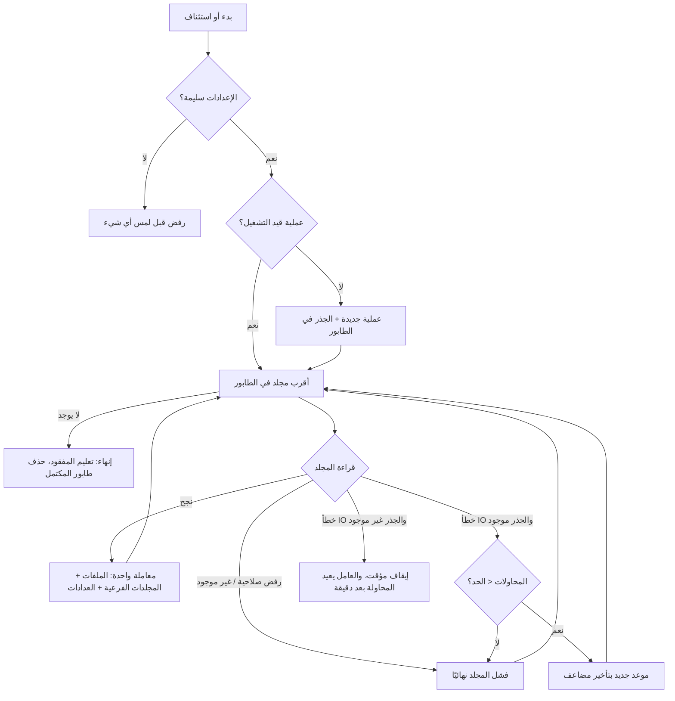

# المرحلتان 0 و1: الأساس والجرد القابل للاستئناف وواجهته

> **الحالة:** منفّذ ومختبَر على بيانات اصطناعية فقط. **غير جاهز للإنتاج** ولم يُوصل بمجلد الشبكة الحقيقي.
> المطلوب قبل الإنتاج موضّح في القسم 9.

---

## 1. ما الذي بُني

| البند | الملف | ما يفعله |
|---|---|---|
| نموذج الجرد | `src/QuestionBank.Core/Inventory/InventoryModel.cs` | `SourceFile` و`ScanRun` و`ScanDirectory` وحالات الملف ورموز الأخطاء |
| الإعدادات | `src/QuestionBank.Core/Inventory/InventoryOptions.cs` | الجذر، النتائج، المحاولات، التأخير، التشغيل عند البدء |
| حدود المسارات | `src/QuestionBank.Core/Inventory/SourcePaths.cs` | التحقق من الجذرين، ورفض أي مسار يخرج عن الجذر |
| قراءة نظام الملفات | `src/QuestionBank.Core/Inventory/SourceFileSystem.cs` | واجهة **قراءة فقط**، وكشف الروابط الرمزية |
| تصنيف الأخطاء | `src/QuestionBank.Core/Inventory/InventoryErrors.cs` | تحويل الاستثناءات إلى رموز، وتحديد ما يستحق الإعادة |
| محرك الجرد | `src/QuestionBank.Core/Inventory/InventoryScanner.cs` | الجرد نفسه (القسم 3) |
| استعلامات الحالة | `src/QuestionBank.Core/Inventory/InventoryQueries.cs` | أعداد حسب الحالة والامتداد، وملخص العمليات |
| قاعدة البيانات | `src/QuestionBank.Core/Data/` | `QuestionBankDbContext` وأول migration |
| المصادقة والأدوار | `src/QuestionBank.Web/Security/AppAuthorization.cs` | Windows Auth، وربط الأدوار بمجموعات AD، وحماية كل النقاط |
| العامل الخلفي | `src/QuestionBank.Web/Services/InventoryWorker.cs` | يستأنف تلقائيًا بعد إعادة التشغيل، ويستقبل الطلبات |
| نقاط API | `src/QuestionBank.Web/Program.cs` | القسم 5 |
| شجرة المجلدات وطابور المعالجة | `src/QuestionBank.Core/Inventory/ProcessingQueue.cs` | المجلدات وأعداد ملفاتها من قاعدة البيانات فقط، وطلبات المعالجة المرتبة |
| الواجهة | `src/QuestionBank.Web/wwwroot/` | لوحة الحالة ومجلد الشبكة (القسم 6.1) |
| الاختبارات | `tests/QuestionBank.Tests/` | 63 اختبارًا (القسم 7) |

**ملفات الحزمة الأصلية** محفوظة كما هي في `docs/handoff/`، والمخطط الأولي في `database/schema.sql` بقي مرجعًا. مصدر الحقيقة لجداول الجرد الآن هو EF Core migration.

---

## 2. قرارات اتُّخذت ولماذا

| القرار | البديل | السبب |
|---|---|---|
| **.NET 10 (LTS)** بدل .NET 8 | البقاء على .NET 8 كما في الحزمة | دعم .NET 8 ينتهي في 10 نوفمبر 2026، أي بعد شهر من اليوم. .NET 10 هو الإصدار طويل الدعم الحالي (حتى نوفمبر 2028) |
| **SQLite** مع EF Core migrations | SQL Server الآن | توفر SQL Server غير معروف، والحزمة تمنع افتراضه. الانتقال لاحقًا يحتاج إضافة مزوّد SQL Server وmigrations خاصة به، ويجب أن يراجعه مسؤول قواعد البيانات |
| **طابور المجلدات في قاعدة البيانات** | التعداد التنازلي المعتاد في الذاكرة | الاستئناف من نفس النقطة بعد أي توقف، بدل المرور من جديد على 23 ألف مجلد |
| **معاملة واحدة لكل مجلد**: ملفاته، والمجلدات الفرعية، وعدادات العملية | حفظ كل ملف على حدة، أو حفظ دفعات كبيرة | التوقف في أي لحظة لا يترك نصف مجلد، ولا يكرر النتائج، والعدادات تبقى متسقة |
| **كشف الروابط بـ `LinkTarget`** وليس بسمة ReparsePoint | تخطي كل ما عليه ReparsePoint | خاصية **Data Deduplication** في Windows Server تضع ReparsePoint على ملفات حقيقية، فتخطيها يفقد ملفات من الجرد |
| **لا بصمة SHA-256 في الجرد** | حساب البصمة لكل ملف الآن | قراءة 24.7 GB كاملة عبر SMB في كل جرد مكلفة. التغيّر يُكشف بالحجم وتاريخ التعديل، والبصمة تُحسب في مرحلة الاستخراج |
| **لا حذف لسجل الملف أبدًا** | حذف الملفات المختفية | التتبع (القيد 8). الملف المختفي يُعلَّم `IsMissing` |
| **رفض الصلاحية لا يُعاد** | إعادة كل خطأ | رفض الصلاحية والمسار غير الموجود لن يتغيرا بالإعادة. أخطاء IO العامة تُعاد بتأخير مضاعف |
| **اختفاء الجذر نفسه يوقف العملية بدون استهلاك المحاولات** | اعتبار كل مجلد فاشلًا | انقطاع الشبكة كان سيفشل كل المجلدات المتبقية. العملية تبقى "قيد التشغيل" ويعيد العامل المحاولة كل دقيقة |
| **الإعداد الناقص يغلق ولا يفتح** | السماح عند غياب ربط الأدوار | دور بلا مجموعات AD مضبوطة لا يدخله أحد |
| **مجموعات AD في الإعدادات** | أسماء أدوار ثابتة في الكود | أسماء المجموعات تختلف بين المؤسسات |

---

## 3. كيف يعمل الجرد



**قواعد كل ملف:**
- **جديد:** يُضاف بحالة `Pending`.
- **تغيّر حجمه أو تاريخه:** يعود إلى `Pending`، وتُمسح بصمته وأخطاؤه، ويزيد `ChangeCount`.
- **لم يتغير:** حالته تبقى كما هي، فملف `Completed` يبقى `Completed`.
- **لم يُرَ في عملية مكتملة:** يُعلَّم `IsMissing`، **إلا** إذا كان تحت مجلد تعذّر جرده، لأن عدم رؤيته هناك لا يعني أنه اختفى.
- **عنصر تعذّرت قراءة معلوماته وحده:** يُسجَّل بحالة `Failed` ورمز الخطأ، وباقي المجلد يُجرد طبيعيًا.
- **رابط رمزي أو junction:** لا يُتبع، ويُعدّ في `LinksSkipped`.

**ما لا يفعله الجرد:** لا يفتح محتوى أي ملف، ولا يكتب في المصدر. الواجهة `ISourceFileSystem` ليس فيها أي عملية كتابة أصلًا.

---

## 4. الإعدادات

في `appsettings.json` أو متغيرات البيئة (`QuestionBank__SourceRoot` مثلًا):

| المفتاح | الافتراضي | الشرح |
|---|---|---|
| `QuestionBank:SourceRoot` | — | مسار UNC للمصدر، مثل `\\FILESERVER\QuestionBankReadOnly` |
| `QuestionBank:OutputRoot` | — | مجلد النتائج. لا يجوز أن يكون داخل المصدر أو العكس |
| `QuestionBank:MaxRetries` | 3 | محاولات المجلد عند خطأ IO مؤقت |
| `QuestionBank:RetryBaseDelaySeconds` | 5 | التأخير قبل المحاولة الثانية، ويتضاعف: 5، ثم 10، ثم 20... |
| `QuestionBank:ScanOnStartup` | false | بدء جرد جديد مع كل تشغيل. العملية غير المكتملة تُستأنف دائمًا بغض النظر عن هذا الإعداد |
| `QuestionBank:EnableWorker` | true | تشغيل العامل الخلفي داخل تطبيق الويب |
| `QuestionBank:BatchSize` | 100 | محفوظ لمراحل المعالجة اللاحقة. الجرد يحفظ بعد كل مجلد |
| `ConnectionStrings:QuestionBank` | `Data Source=App_Data/questionbank.db` | **على قرص الخادم المحلي، وليس على مشاركة شبكة.** SQLite على SMB قد يتلف |
| `Authentication:Mode` | Windows | `Development` يُرفض خارج بيئة Development |
| `Authorization:Roles:<الدور>` | `CORP\QB-...` | مجموعات AD لكل دور: Admin، BankManager، Reviewer، Viewer. **يجب تغييرها لأسماء مجموعاتكم** |
| `AllowedHosts` | `qbank.local;localhost` | اسم الموقع الداخلي |

---

## 5. نقاط API

| الطريقة | المسار | الصلاحية | الوظيفة |
|---|---|---|---|
| GET | `/health` | بدون دخول | فحص أن التطبيق يعمل |
| GET | `/api/me` | أي دور | اسم المستخدم وأدواره |
| GET | `/api/config/paths` | مدير النظام | هل المسارات مضبوطة ومتاحة، والمشاكل. **لا يعرض المسارات** |
| GET | `/api/inventory/status` | مدير أو مسؤول بنك | العملية الجارية، وآخر عملية، والأعداد حسب الحالة والامتداد، ومشكلة العامل إن وجدت |
| POST | `/api/inventory/scan` | مدير أو مسؤول بنك | بدء جرد أو استئنافه |
| POST | `/api/inventory/abandon` | مدير أو مسؤول بنك | التخلي عن العملية الجارية نهائيًا |
| GET | `/api/inventory/tree?path=` | مدير أو مسؤول بنك | المجلدات المباشرة تحت مسار، مع عدد الملفات حسب الحالة. **من قاعدة البيانات فقط**، ولا يلمس نظام الملفات |
| GET | `/api/queue` | مدير أو مسؤول بنك | طلبات المعالجة المنتظرة بالترتيب |
| POST | `/api/queue` | مدير أو مسؤول بنك | إضافة مجلد (`{"path": "إداري/2023"}`). الطلب المكرر يعيد الطلب الموجود |
| DELETE | `/api/queue/{id}` | مدير أو مسؤول بنك | إزالة طلب لم تبدأ معالجته |
| GET | `/` | أي دور | الواجهة |

أي مسار آخر، حتى غير الموجود، يعيد 401 لغير المصادَق. هذه "السياسة الاحتياطية" التي تمنع ظهور صفحة بلا حماية.

---

## 6. التشغيل والاختبار

### المتطلبات
- .NET SDK 10. الملف `global.json` يقبل أي إصدار 10.0.1xx أو أحدث.
- على Windows: يُنزَّل من موقع Microsoft الرسمي أو بالأمر `winget install Microsoft.DotNet.SDK.10`.

### الأوامر (من جذر المستودع)
```powershell
dotnet build
dotnet test
```

### تشغيل محلي للتجربة
```powershell
$env:ASPNETCORE_ENVIRONMENT = "Development"
$env:QuestionBank__SourceRoot = "D:\qb-sample\source"   # مجلد تجريبي غير سري
$env:QuestionBank__OutputRoot = "D:\qb-sample\output"
dotnet run --project src/QuestionBank.Web
```
ثم:
```powershell
Invoke-RestMethod -Method Post http://localhost:5000/api/inventory/scan
Invoke-RestMethod http://localhost:5000/api/inventory/status
```
في وضع Development يدخل المستخدم تلقائيًا كـ `DEV\developer` بكل الأدوار.

### 6.1 الواجهة
افتح عنوان التطبيق في المتصفح. الواجهة عربية، وتعمل على الجوال، وتتبع الوضع الداكن للجهاز.

| الشاشة | ما فيها |
|---|---|
| **لوحة الحالة** | الملفات المسجلة، وبانتظار المعالجة، والمكتملة، والفاشلة، والمفقودة. تفاصيل آخر عملية أو العملية الجارية مع شريط تقدم. توزيع الصيغ. زر بدء الجرد أو استئنافه، وزر إيقاف نهائي بتأكيد داخل الصفحة. تتحدث كل ثانيتين أثناء الجرد |
| **مجلد الشبكة** | شجرة المجلدات تُفتح تدريجيًا، وبجانب كل مجلد عدد ملفاته وشريط صغير لحالاتها. **اسحب المجلد إلى قائمة المعالجة**، أو اضغط «أضف» (بديل للمس ولوحة المفاتيح). الطلب المكرر يُرفض برسالة، وكل إضافة لها زر «تراجع» |

**قرارات الواجهة:**
- **بلا أي مكتبة أو خط خارجي:** HTML وCSS وJavaScript عادية تُخدم من التطبيق نفسه، وخطوط النظام التي تدعم العربية (Segoe UI وTahoma على Windows). لا طلب يخرج من الشبكة (القيد 1).
- **الواجهة خلف الصلاحيات:** الملفات الثابتة تُخدم بعد فحص الصلاحية، فلا يرى حتى الصفحة من ليس له دور.
- **أرقام غربية (0-9):** الصفر العربي (٠) يظهر كنقطة في البطاقات الكبيرة فيوحي بأنها فارغة.
- **الطابور يحفظ الطلبات فقط:** الاستخراج يبدأ في المرحلة 2، والواجهة تقول ذلك صراحة.
- **شاشات المراحل القادمة** ظاهرة في القائمة باهتة مع كلمة «قريبًا».

تحققت من الواجهة بمتصفح آلي: بدء الجرد، وفتح الشجرة، وسحب مجلد وإفلاته، والإضافة بالزر، ورفض المكرر، والعرض على الجوال بعرض 400 بكسل في الوضع الداكن. لم يظهر أي خطأ في المتصفح، ولا تمرير أفقي.

### نتيجة فعلية مُقاسة في بيئة التطوير
مجلد اصطناعي فيه 300 ملف في 10 مجلدات، ورابط رمزي إلى `/etc`:

```json
"directoriesCompleted": 10, "filesSeen": 300, "filesNew": 300,
"linksSkipped": 1, "filesByStatus": { "Pending": 300 }
```

استغرق الجرد أقل من نصف ثانية، وسجل التطبيق لم يحتوِ أي مسار أو اسم ملف من المصدر. **هذا ليس قياس أداء** لمشاركة SMB حقيقية؛ القياس الفعلي مطلوب على الخادم (القسم 9).

---

## 7. الاختبارات

**63 اختبارًا، جميعها ناجحة.** تعمل على مجلدات مؤقتة وملفات اصطناعية، ولا تستخدم أي بيانات حقيقية.

| المجموعة | ما تثبته |
|---|---|
| الجرد الأول | كل الملفات مسجلة بمسار نسبي وحالة Pending، مع الامتداد بأحرف صغيرة |
| **المصدر لا يتغير** | بصمة SHA-256 والحجم والتاريخ لكل ملف متطابقة قبل جردين وبعدهما |
| إعادة الجرد | لا تكرار، والحالات تبقى كما هي |
| الملف المتغير | يعود إلى Pending، وتُمسح بصمته، ويزيد عداد التغيّر |
| الملف المحذوف | يُعلَّم مفقودًا ولا يُحذف، ويعود إذا ظهر الملف من جديد |
| **الروابط الرمزية** | رابط مجلد ورابط ملف يشيران خارج الجذر: لا يُتبعان، ولا يظهر شيء مما خلفهما |
| **الاستئناف** | إيقاف بعد 3 مجلدات، ثم سياق قاعدة جديد (كإعادة تشغيل الخدمة): 24 ملفًا بلا تكرار، وعملية واحدة فقط |
| رفض الصلاحية | يُسجَّل برمزه، ويكمل الجرد، ولا يُعاد، ولا تُعلَّم ملفات المجلد مفقودة |
| خطأ IO مؤقت | يُعاد وينجح، أو يتوقف بعد الحد الأقصى من المحاولات |
| **التأخير المضاعف** | بساعة محاكاة: الجرد ينتظر فعلًا 5 ثوانٍ قبل الإعادة |
| انقطاع الجذر | لا يستهلك محاولات المجلد، والعملية تُستأنف وتكتمل بعد عودته |
| عنصر متعذر القراءة | يُسجَّل Failed، والباقي يُجرد |
| التخلي عن عملية | لا تُستأنف، والجرد التالي يبدأ من جديد |
| إعدادات خاطئة | تُرفض قبل إنشاء أي سجل |
| المسارات | رفض `..` و`./` والمسارات المطلقة والمقاطع الفارغة، والتمييز بين `root` و`root-other` |
| شجرة المجلدات | أعداد تنازلية صحيحة حسب الحالة، وعدم الخلط بين `Admin` و`admin-old` أو بين حالات الأحرف، واستبعاد الملفات المفقودة، ورفض `..` و`\` والمسارات المطلقة |
| طابور المعالجة | تسجيل الطالب وعدد الملفات، وتجاهل المكرر، ورفض المجلد غير الموجود، والإزالة ثم الإضافة من جديد |
| **الأمن (على Kestrel حقيقي)** | `/health` فقط بلا دخول. كل نقطة أخرى، **ومنها صفحة الواجهة وملفاتها**، تعيد 401 مع `Negotiate`. الأدوار تتبع مجموعات AD (11 حالة). `/api/config/paths` لا يكشف المسارات. وضع Development مرفوض في Production |

---

## 8. حدود معروفة

| الحد | الأثر | المعالجة المقترحة |
|---|---|---|
| لم يُختبر على Windows وSMB حقيقي | سلوك UNC وصلاحيات NTFS والملفات المقفلة على Windows لم يُرَ فعليًا | تشغيل الاختبارات على Windows، ثم جرد مجلد تجريبي على المشاركة |
| شجرة المجلدات تُحسب من كل ملفات المجلد في كل طلب | مع 78 ألف ملف قد يستغرق فتح الجذر جزءًا من الثانية | جدول مجلدات مُجمَّع يُحدَّث مع الجرد، إذا أظهر القياس الحاجة |
| التحديث بالاستطلاع كل ثانيتين | حمل بسيط على الخادم أثناء الجرد | SignalR عند الحاجة |
| فهرس `RelativePath` حساس لحالة الأحرف في SQLite | إعادة تسمية ملف بتغيير حالة الأحرف فقط تُسجَّل كملف مفقود وملف جديد | مقبول حاليًا. SQL Server بترتيب غير حساس للأحرف يحلها |
| المجلد الكبير جدًا يُحفظ في معاملة واحدة | مجلد فيه مئات آلاف الملفات يستهلك ذاكرة أكبر | لا يُتوقع في البنك الحالي (المتوسط نحو 3 ملفات لكل مجلد). يُراقب في القياس الفعلي |
| العامل داخل تطبيق الويب | إعادة تدوير IIS لـ Application Pool توقف الجرد، وهو يُستأنف لاحقًا | نقله إلى Windows Service مستقلة قبل الجرد الكامل، كما في الحزمة |
| `Negotiate` على Linux | يحتاج إعداد Kerberos | الإنتاج على Windows Server وIIS حسب الحزمة، فلا أثر |
| اختبار الروابط الرمزية على Windows | إنشاء رابط رمزي على Windows يحتاج Developer Mode أو صلاحية مدير، وإلا يفشل هذا الاختبار وحده | تشغيل الاختبارات بحساب له هذه الصلاحية، أو تفعيل Developer Mode على جهاز التطوير |

---

## 9. المطلوب قبل الإنتاج

1. **أسماء مجموعات AD الحقيقية** لكل دور.
2. **تشغيل الاختبارات على Windows Server** نفسه أو مثيله.
3. **جرد مجلد تجريبي غير سري على مشاركة SMB حقيقية**، مع قياس الزمن ومقارنة عدد الملفات يدويًا.
4. **اختبار حساب الخدمة:** قراءة فقط على المصدر (NTFS والمشاركة معًا)، وكتابة في مجلد النتائج وملف القاعدة فقط.
5. **اختبار الاستئناف على الخادم:** إيقاف الخدمة أثناء الجرد، وفصل الشبكة، وملف مقفل.
6. **HTTPS بشهادة داخلية** وIIS مع Windows Authentication.
7. **نسخ احتياطي لملف القاعدة**، أو الانتقال إلى SQL Server بعد مراجعة مسؤول قواعد البيانات.
8. **موافقة تقنية المعلومات ومسؤول بنك الأسئلة** قبل توجيه الجرد إلى المجلد الكامل.
