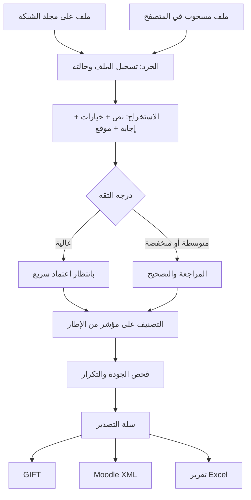
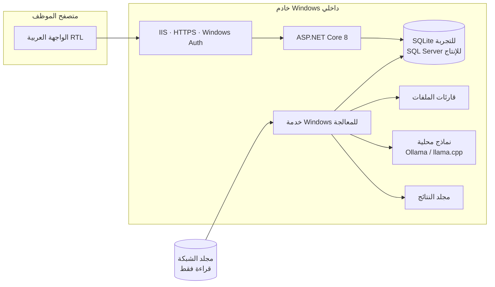

# مشروع بنك الأسئلة الداخلي: الشرح الكامل

> هذا الملف هو نقطة البداية لأي شخص ينضم للمشروع: مطوّر، أو مسؤول تقنية معلومات، أو مراجع، أو صاحب قرار.
> يشرح الفكرة والقيود والبنية والشاشات وخطة العمل، وما أُنجز وما لم يُنجز.
> التفاصيل الموسّعة في [`docs/interface/PROPOSAL_AR.md`](interface/PROPOSAL_AR.md)، والنموذج التفاعلي في [`docs/interface/prototype.html`](interface/prototype.html).

**آخر تحديث:** 13 أكتوبر 2026، بعد تنفيذ المرحلتين 0 و1، والجزء الأول من المرحلة 2، والمراجعة، والتصدير، والتكرار والتقارير

---

## المحتويات
1. [الفكرة باختصار](#1-الفكرة-باختصار)
2. [المشكلة التي يحلها](#2-المشكلة-التي-يحلها)
3. [القيود الإلزامية](#3-القيود-الإلزامية)
4. [المستخدمون والأدوار](#4-المستخدمون-والأدوار)
5. [رحلة السؤال من الملف إلى Moodle](#5-رحلة-السؤال-من-الملف-إلى-moodle)
6. [البنية التقنية](#6-البنية-التقنية)
7. [الشاشات](#7-الشاشات)
8. [استخراج الأسئلة](#8-استخراج-الأسئلة)
9. [التصنيف على أطر الكفايات](#9-التصنيف-على-أطر-الكفايات)
10. [الجودة والتكرار](#10-الجودة-والتكرار)
11. [التصدير: GIFT وMoodle XML وExcel](#11-التصدير-gift-وmoodle-xml-وexcel)
12. [قاعدة البيانات](#12-قاعدة-البيانات)
13. [الأمن والنشر](#13-الأمن-والنشر)
14. [محتويات المستودع اليوم](#14-محتويات-المستودع-اليوم)
15. [ما أُنجز وما لم يُنجز](#15-ما-أنجز-وما-لم-ينجز)
16. [خطة المراحل](#16-خطة-المراحل)
17. [المخاطر](#17-المخاطر)
18. [القرارات المفتوحة](#18-القرارات-المفتوحة)
19. [مسرد المصطلحات](#19-مسرد-المصطلحات)

---

## 1. الفكرة باختصار

تطبيق ويب **داخلي** يعمل على خادم Windows داخل شبكة المؤسسة، ويفتحه الموظفون من المتصفح برابط مثل `https://qbank.local` بدون تثبيت أي برنامج. وظيفته:

1. **يقرأ** بنك الأسئلة الموجود على مجلد الشبكة، وحجمه نحو 24.7 GB في 78,554 ملفًا و23,173 مجلدًا، أو ملفات يسحبها المستخدم ويفلتها في الواجهة.
2. **يستخرج** الأسئلة من ملفات Word وExcel وPDF وغيرها، مع الخيارات والإجابة الصحيحة ومصدر كل سؤال.
3. **يعرضها للمراجعة** في واجهة سهلة جدًا، فيصحح المراجع ما أخطأ فيه الاستخراج دون المساس بالأصل.
4. **يربطها** بمؤشرات أطر الكفايات الوظيفية المعتمدة، بمساعدة نموذج ذكاء اصطناعي محلي.
5. **يفحص** الجودة والتكرار والتغطية.
6. **يصدّر** ملفات GIFT وMoodle XML جاهزة للاستيراد في Moodle، وتقارير Excel.

---

## 2. المشكلة التي يحلها

| الوضع الحالي | بعد المشروع |
|---|---|
| عشرات آلاف الملفات بأشكال مختلفة في مجلدات متفرقة | فهرس واحد قابل للبحث لكل الأسئلة |
| لا يُعرف كم سؤالًا لكل مؤشر، ولا أين النقص | خريطة تغطية لكل مؤشر |
| تكرار غير معروف بين الملفات والسنوات | مجموعات تكرار معروضة جنبًا إلى جنب، تقرر فيها اللجنة |
| نقل الأسئلة إلى Moodle يدوي وبطيء ومعرّض للخطأ | تصدير آلي مفحوص بصيغتي GIFT وXML |
| لا تتبع لمصدر السؤال بعد نقله | كل سؤال يحمل معرّفًا ثابتًا ومصدره وموقعه في الملف |

---

## 3. القيود الإلزامية

هذه القيود من ملف التسليم الأصلي، ولا يجوز خرقها في أي مرحلة:

| # | القيد | كيف يحققه التصميم |
|---|---|---|
| 1 | **السرية:** لا تخرج البيانات من الشبكة | كل شيء على الخادم الداخلي، والذكاء الاصطناعي محلي، والإنترنت محجوب عن الخادم، ولا مكتبات من CDN خارجي |
| 2 | **المصدر لا يُعدّل** | حساب الخدمة له قراءة فقط على المصدر، والملفات المرفوعة تُحفظ في مجلد النتائج |
| 3 | **الإطار المعتمد هو المرجع الوحيد** | المؤشرات تُستورد من ملفات الإطار فقط، ولا يوجد في الواجهة زر لإنشاء مؤشر، والنموذج يختار من قائمة مغلقة |
| 4 | **النص الأصلي محفوظ** | التصحيحات طبقة منفصلة فوق الأصل، ولا إعادة صياغة تلقائية |
| 5 | **كل ربط له دليل** | درجة ومبرر وحالة، والحالات غير المؤكدة تُحال للمراجع |
| 6 | **لا حذف تلقائي للمكرر** | التكرار يُعرض فقط، واللجنة تقرر |
| 7 | **الاستئناف** | المعالجة على دفعات، وحالتها في قاعدة البيانات، فتستأنف بعد أي توقف |
| 8 | **التتبع** | معرّف ثابت، والمصدر، والموقع، ووقت الاستخراج، وإصدار الإطار |
| 9 | **تصدير سليم** | فحص البنية قبل التصدير، والمرفوض يذهب لتقرير أخطاء |
| 10 | **لا نصوص في السجلات** | السجلات تحمل المعرّفات ورموز الأخطاء فقط |

---

## 4. المستخدمون والأدوار

| الدور | المهام |
|---|---|
| **مدير النظام** | الإعدادات، والأدوار، والنماذج، ومراقبة الخادم |
| **مسؤول بنك الأسئلة** | إضافة المجلدات، ورفع الملفات، واستيراد الأطر، وتوزيع المهام، والتصدير |
| **المراجع الفني** | تصحيح الاستخراج، والتصنيف، والاعتماد، والتعليم للجنة |
| **مستخدم الاطلاع** | البحث في الأسئلة المعتمدة ضمن صلاحيته |

- **الدخول تلقائي** عبر Windows Authentication، بحساب الموظف في الشبكة.
- **الأدوار** تُربط بمجموعات Active Directory.
- **عدة أشخاص** يعملون في الوقت نفسه، ولكل منهم قائمة مهامه.

---

## 5. رحلة السؤال من الملف إلى Moodle



**حالات الملف:** بالانتظار ← قيد المعالجة ← مكتمل، أو فشل، أو تم تخطيه، أو يحتاج مراجعة.
**حالات السؤال:** مستخرج ← بانتظار المراجعة ← معتمد، أو معلّم للجنة.
**حالات الربط:** Matched (مطابق) أو NeedsReview (يحتاج مراجعة) أو Unmatched (بلا مطابقة).

---

## 6. البنية التقنية



| الطبقة | الاختيار | السبب |
|---|---|---|
| الخادم | ASP.NET Core على .NET 10 LTS | دعم .NET 8 المذكور في الحزمة ينتهي في نوفمبر 2026، و.NET 10 مدعوم حتى نوفمبر 2028 |
| الواجهة | Razor Pages أو Blazor Server، مع JavaScript خفيف للسحب والإفلات | تقنية واحدة يصونها فريق صغير |
| التحديث الحي | SignalR | يعرض نسبة الإنجاز دون إعادة تحميل الصفحة |
| الرفع | Uppy مع tusdotnet، مستضافان داخليًا | رفع يستأنف بعد انقطاع الشبكة |
| المعالجة | Windows Service مع طابور في قاعدة البيانات | مستقلة عن الواجهة وتستأنف بعد التوقف |
| قاعدة البيانات | EF Core: SQLite ثم SQL Server | نبدأ بلا تثبيت، والانتقال يتم بتغيير سطر الاتصال |
| الذكاء الاصطناعي | BGE-M3، ثم bge-reranker-v2-m3، ثم Qwen3-14B عبر Ollama | محلي بالكامل، والتفاصيل في القسم 9 |
| التقارير | ClosedXML | ملفات Excel بدون Office على الخادم |

---

## 7. الشاشات

كلها مرسومة في النموذج التفاعلي [`prototype.html`](interface/prototype.html). كل عملية سحب لها بديل بالنقر.

| الشاشة | وظيفتها | أبرز الأفكار |
|---|---|---|
| **لوحة الحالة** | صورة سريعة عن التقدم | أرقام كبيرة، وتوزيع الصيغ، وحالات الملفات، والوقت المتبقي |
| **إسقاط الملفات** | رفع ملفات أو مجلدات أو ZIP | كشف التكرار بالبصمة، ورسائل خطأ مفهومة، ورفع يستأنف |
| **مجلد الشبكة** | معالجة الملفات من مكانها | شجرة بالمسارات النسبية، وسحب المجلد إلى قائمة المعالجة، وإيقاف واستئناف |
| **مطابقة الأعمدة** | تعليم النظام شكل ملف Excel | سحب الأعمدة إلى الحقول، وقوالب تُطبَّق تلقائيًا على الملفات المشابهة |
| **المراجعة** | تصحيح ما أخطأ فيه الاستخراج | السؤال مع مصدره، وتعيين الإجابة بنقرة، واختصارات لوحة المفاتيح، وتراجع |
| **التصنيف** | ربط السؤال بمؤشر | سحب إلى المؤشر، و3 اقتراحات من النموذج، وتنبيه للمؤشر الفارغ |
| **سلة التصدير** | تجميع الأسئلة وتصديرها | GIFT وMoodle XML وExcel، مع فحص البنية قبل الإخراج |

**مبادئ السهولة:** دخول بلا كلمة مرور، وعربية أولًا، ولا نوافذ تأكيد (تراجع بدلًا منها)، والحالة بلون ونص معًا، ولا مسارات خادم ظاهرة.

---

## 8. استخراج الأسئلة

### القارئات

| الصيغة | الطريقة | الأولوية |
|---|---|---|
| DOCX | `DocumentFormat.OpenXml`، ويقرأ التنسيق لكشف الإجابة | 1 |
| XLSX | `ClosedXML` مع قوالب الأعمدة | 1 |
| TXT / MD | أنماط ترقيم عربية وإنجليزية، وكشف الترميز | 1 |
| GIFT | محلل مع اختبار ذهاب وعودة | 1 |
| XLS | `ExcelDataReader` | 2 |
| DOC | تحويل محلي إلى DOCX بـ LibreOffice | 2 |
| PDF نصي | `PdfPig` | 2 |
| PDF مصوّر وصور | Tesseract OCR محلي، ومراجعته إلزامية | 3 |

### تحديد الإجابة الصحيحة
الملفات تحدد الإجابة **بأكثر من طريقة**، فيجرّب النظام سلسلة كواشف بالترتيب:

1. عمود صريح في Excel.
2. علامة `=` في GIFT.
3. رمز مثل `*` أو `✓`.
4. جدول إجابات في آخر الملف.
5. خط عريض أو لون أو تسطير يميّز خيارًا واحدًا.

- إذا اتفق كاشفان ترتفع الثقة. وإذا تعارضا، أو لم يُعثر على أي علامة، يُحال السؤال للمراجعة.
- عندما يصحح المراجع ملفًا يحفظ النظام "شكله" كقالب، ويطبقه على الملفات المشابهة.

### ما يُحفظ لكل سؤال
المعرّف الثابت، والنص والخيارات بترتيبها، والإجابة الأصلية، والرمز، والموقع في الملف (صفحة أو صف أو سطر)، والكاشف المستخدم، ودرجة الثقة، وإصدار القارئ.

---

## 9. التصنيف على أطر الكفايات

خط معالجة من ثلاث طبقات، كلها على الخادم:

| الطبقة | النموذج | الوظيفة |
|---|---|---|
| 1. التضمين | BGE-M3 (رخصة MIT) | يختار أقرب 10 إلى 20 مؤشرًا لكل سؤال، وسريع حتى على CPU |
| 2. إعادة الترتيب | bge-reranker-v2-m3 (Apache 2.0) | يرتّب المرشحين بدقة أعلى |
| 3. النموذج اللغوي | Qwen3-14B، أو 32B إذا سمح العتاد (Apache 2.0) | للحالات الغامضة فقط: يختار من المرشحين ويكتب مبررًا |

- **النموذج لا يرى إلا مؤشرات الإطار**، ويجب أن يختار منها أو يقول "لا يوجد مناسب".
- **حدود الثقة لا تُحدد مسبقًا.** تُقاس على عينة من 200 إلى 300 سؤال يصنفها المختصون يدويًا، ويُختار النموذج النهائي بالتجربة نفسها.
- **العتاد:** بطاقة رسومية بذاكرة 16 إلى 24 GB تكفي. بدونها يعمل التضمين على المعالج، ويُستخدم نموذج لغوي أصغر للحالات الغامضة فقط.
- **مستوى الثقة في ترتيب النماذج متوسط**، لأن المقارنات العامة للعربية قليلة. المرشحون البدلاء: Gemma 3 27B، وALLaM-7B (بعد التحقق من رخصته).

---

## 10. الجودة والتكرار

| النوع | الطريقة | يحذف؟ |
|---|---|---|
| تكرار حرفي | بصمة بعد تطبيع: إزالة التشكيل وتوحيد الهمزات، دون تغيير النص المحفوظ | لا |
| شبه تكرار | تشابه نصي | لا |
| تداخل مفاهيمي | تشابه التضمين، ثم تأكيد بالنموذج | لا |
| بنية السؤال | قواعد: نص، وخياران أو أكثر، وإجابة واحدة | يُرفض من التصدير فقط |
| سلامة النص | قواعد ونموذج: "كل ما سبق"، ونفي مزدوج، وأخطاء لغوية، وخياران صحيحان | لا، اقتراح فقط |
| تلميح الإجابة | طول الإجابة الصحيحة، وتوازن مواضع الإجابات | لا، تقرير فقط |
| التغطية | عدد الأسئلة لكل مؤشر، والمؤشرات الفارغة | — |

---

## 11. التصدير: GIFT وMoodle XML وExcel

| الصيغة | المزايا | الاستخدام |
|---|---|---|
| **GIFT** | نص بسيط يُقرأ ويُعدّل يدويًا | الاستيراد السريع |
| **Moodle XML** | فئات لكل مؤشر، ومعرّف `idnumber`، ووسوم، وصور مضمّنة، واتجاه RTL | الاستيراد المنظم والدائم |
| **Excel** | جرد الملفات، والأسئلة، والمطابقات، والتكرار، والتغطية، والأخطاء | التقارير واللجان |

**قواعد التصدير:**
- ترتيب الخيارات الأصلي محفوظ، والخلط اختياري.
- الرموز الخاصة تُهرَّب.
- الترميز UTF-8.
- الأسئلة غير السليمة لا تدخل الملف، وتظهر في تقرير أخطاء.
- كل عملية تصدير تُحفظ بإعداداتها ومن طلبها.

مثال XML كامل وجدول قراراته في [`PROPOSAL_AR.md` القسم 4.7.1](interface/PROPOSAL_AR.md).

---

## 12. قاعدة البيانات

- **للتجربة:** SQLite، بلا تثبيت.
- **للإنتاج:** SQL Server إذا كان متوفرًا لدى المؤسسة، أو SQL Server Express المحدود بحجم 10 GB لكل قاعدة.
- **بديل:** PostgreSQL إذا تجاوز الحجم حد Express.

**الجداول الأساسية** (المخطط الأولي في الحزمة، مع إضافات مقترحة):

| المجموعة | الجداول |
|---|---|
| الملفات | `SourceFiles`، و`Uploads`، و`ProcessingRuns` |
| الأسئلة | `Questions`، و`QuestionCorrections` (طبقة التصحيح)، و`ExtractionTemplates` |
| الأطر | `CompetencyFrameworks`، و`CompetencyIndicators` |
| المطابقة | `QuestionMatches`، و`ModelRuns` |
| الجودة | `QualityFindings`، و`DuplicateGroups`، و`DuplicateGroupMembers` |
| العمل | `ReviewAssignments`، و`Exports`، و`AuditLog` |

---

## 13. الأمن والنشر

- **الشبكة:** HTTPS بشهادة داخلية، والوصول من أجهزة المؤسسة فقط، ولا منفذ مفتوح على الإنترنت.
- **الخادم:** محجوب عن الإنترنت بجدار الحماية، والنماذج تُنقل إليه يدويًا بعد فحصها.
- **حساب الخدمة:** حساب مخصص (يفضّل gMSA)، له قراءة فقط على المصدر وتعديل على مجلد النتائج فقط، وبلا صلاحيات مدير.
- **الملفات المرفوعة:** تُفحص بمضاد الفيروسات، مع حدود للصيغ والحجم.
- **الإعدادات:** لا كلمات مرور في `appsettings.json`، وصفحات الأخطاء التفصيلية مغلقة في الإنتاج.
- **السجلات:** المعرّفات فقط، دون نصوص الأسئلة.
- **قبل المعالجة الكاملة:** اختبار الاستعادة، وانقطاع SMB، والملفات المقفلة، والنسخ الاحتياطي، والأداء.

تعليمات النشر التفصيلية في ملف `docs/DEPLOYMENT_AR.md` ضمن حزمة التسليم.

---

## 14. محتويات المستودع اليوم

```
Exam-organization-/
├── QuestionBank.slnx           الحل (.NET 10)
├── global.json                 إصدار SDK المطلوب
├── src/
│   ├── QuestionBank.Core/      منطق المشروع بلا واجهة
│   │   ├── Inventory/          الجرد: النموذج، المسارات، القراءة، المحرك، الاستعلامات، طابور المجلدات
│   │   ├── Extraction/         القارئات (GIFT، TXT)، حفظ الأسئلة، الرفع، معالجة الطابور
│   │   ├── Review/             المراجعة وطبقة التصحيح وسجل التدقيق
│   │   ├── Export/             التصدير إلى GIFT وMoodle XML مع الفحص الذاتي
│   │   ├── Quality/            التطبيع الآمن وكشف التكرار
│   │   ├── Reports/            تقرير Excel المتدفق
│   │   └── Data/               قاعدة البيانات وmigrations
│   └── QuestionBank.Web/       الخادم: المصادقة والأدوار، العامل الخلفي، نقاط API، والواجهة (wwwroot)
├── tests/QuestionBank.Tests/   168 اختبارًا للجرد والقارئات والرفع والمراجعة والتصدير والتكرار والتقارير والأمن
├── database/schema.sql         المخطط الأولي من الحزمة (مرجع)
├── docs/
│   ├── PROJECT_OVERVIEW_AR.md  ← هذا الملف
│   ├── INVENTORY_AR.md         شرح المرحلتين 0 و1: القرارات والإعدادات والاختبارات والحدود
│   ├── EXTRACTION_AR.md        شرح المرحلة 2 (الجزء الأول): القارئات والرفع والطابور
│   ├── REVIEW_AR.md            المراجعة والتصحيح وسجل التدقيق
│   ├── EXPORT_AR.md            التصدير إلى GIFT وMoodle XML
│   ├── QUALITY_AR.md           التكرار، وفك ZIP الآمن، وتقرير Excel
│   ├── handoff/                ملفات حزمة التسليم الأصلية كما هي
│   └── interface/
│       ├── prototype.html      النموذج التفاعلي للواجهة (بيانات وهمية)
│       └── PROPOSAL_AR.md      الأفكار والمقترحات والخطة التفصيلية
└── question-bank-app/          تطبيق قديم (Python / Streamlit) غير مستخدم
```

**عن التطبيق القديم `question-bank-app`:**
- هدفه مختلف: **يولّد** أسئلة جديدة من وصف وظيفي بالذكاء الاصطناعي، ولا يستخرج أسئلة موجودة.
- يرسل النصوص إلى خدمة خارجية (Anthropic API)، وهذا **يخالف القيد 1**. لا يُستخدم مع بيانات حقيقية.
- لم يُمسّ. اقتراح نقله إلى `legacy/` أو حذفه **ينتظر موافقتك**.

---

## 15. ما أُنجز وما لم يُنجز

| البند | الحالة |
|---|---|
| قراءة الحزمة وتحليل نواقصها | ✅ منجز |
| حسم القرارات الأساسية | ✅ منجز |
| النموذج التفاعلي للواجهة: 7 شاشات، مع تصدير GIFT وMoodle XML | ✅ منجز ومفحوص في المتصفح |
| ملف المقترحات وهذا الملف الشامل | ✅ منجز |
| **المرحلة 0:** Windows Auth، وأدوار من مجموعات AD، وحماية كل النقاط، وقاعدة SQLite مع migrations | ✅ منجز ومختبَر |
| **المرحلة 1 (الخادم):** جرد قابل للاستئناف، بلا اتباع للروابط، بمحاولات محدودة، ولا يعدّل المصدر | ✅ منجز ومختبَر على بيانات اصطناعية |
| **المرحلة 1 (الواجهة):** لوحة الحالة، ومجلد الشبكة بالسحب والإفلات، وطابور المعالجة | ✅ منجز ومختبَر في المتصفح |
| التشغيل على Windows Server وSMB حقيقي | ⏳ يحتاج بيئتكم |
| **المرحلة 2 (الجزء الأول):** قارئا GIFT وTXT، وحفظ الأسئلة بمعرّف ثابت، والرفع بالسحب والإفلات مع كشف المكرر، ومعالجة طابور المجلدات، وحماية CSRF | ✅ منجز ومختبَر |
| قارئا Word وExcel | ⏳ ينتظر العينات |
| **المراجعة:** طبقة التصحيح، والاعتماد، والتعليم للجنة، وإعادة الفتح، وسجل التدقيق، وحماية عمل المراجعين عند تغيّر الملفات | ✅ منجز ومختبَر |
| **التصدير:** GIFT وMoodle XML للمعتمد فقط، مع فحص ذاتي قبل الحفظ، وسجل لكل عملية، وسلة بالسحب والإفلات | ✅ منجز ومختبَر (لم يُجرَّب في Moodle حقيقي بعد) |
| **التكرار الحرفي** (مع علامة للنسخ المتطابقة بإجابات مختلفة)، و**فك ZIP الآمن**، و**تقرير Excel** | ✅ منجز ومختبَر |
| شبه التكرار والتداخل المفاهيمي | ⏳ مع مرحلة التصنيف |
| التصنيف على أطر الكفايات والذكاء الاصطناعي المحلي | ⏳ يحتاج عينة إطار |

**كيف بُني .NET في بيئة التطوير:** موقع Microsoft للتنزيل محجوب في بيئة العمل السحابية، فاستُخدمت حزمة .NET SDK 10 الرسمية المعاد تغليفها في conda-forge، وثُبتت في مجلد المستخدم فقط دون تعديل النظام. الأوامر والنتائج في [`INVENTORY_AR.md`](INVENTORY_AR.md).

---

## 16. خطة المراحل

| المرحلة | المحتوى | معيار الإنجاز |
|---|---|---|
| **0. الأساس** ✅ | بناء ناجح، وWindows Auth والأدوار، وحماية نقاط الإعدادات، وEF Core مع SQLite | دخول بالحساب، ولا صفحة بلا حماية |
| **1. الجرد** ✅ | جرد قابل للاستئناف، ومتصفح المجلد، وقائمة المعالجة، ولوحة الحالة | التوقف لا يفقد التقدم ولا يكرر النتائج، والمصدر لم يتغير |
| **2. الإسقاط والقارئات** (GIFT وTXT والرفع ✅، Word وExcel ⏳) | رفع يستأنف، والبصمة، وقارئات XLSX وDOCX وTXT وGIFT، وقوالب الأعمدة | دقة استخراج مقاسة على عينات |
| **3. المراجعة والتصدير** | المراجعة، وطبقة التصحيح، والسلة، وGIFT وXML وExcel | استيراد ناجح في Moodle تجريبي |
| **4. صيغ إضافية** | XLS وDOC وPDF، وOCR اختياري | اختبارات لكل قارئ |
| **5. الأطر والتصنيف** | استيراد الأطر، وخط النماذج الثلاثي، وتجربة اختيار النموذج | Top-3 مقاس، ولا مؤشر خارج الإطار |
| **6. الجودة** | التكرار، والسلامة، والتغطية | تقارير منفصلة، وبلا حذف تلقائي |
| **7. الإنتاج** | الأداء، والاستعادة، والنسخ الاحتياطي | موافقة تقنية المعلومات ومسؤول البنك |

---

## 17. المخاطر

| الخطر | الوقاية |
|---|---|
| تنوع أشكال ملفات Word يضعف الاستخراج | كواشف متعددة، وقوالب، ودرجة ثقة، ومراجعة بشرية |
| الثقة الزائدة بدرجة النموذج | مبرر محفوظ، وحدود مقاسة، واعتماد بشري |
| تسرب البيانات خارج الشبكة | حجب الإنترنت، ولا CDN، ومراجعة الحزم |
| رفع ملف خبيث | مضاد فيروسات، وحدود الصيغ، وحساب محدود |
| OCR عربي ضعيف | اختياري، ويُعلَّم دائمًا للمراجعة |
| بطء النموذج اللغوي | خط ثلاثي الطبقات، وGPU إن أمكن |
| تجاوز حد SQL Server Express | مراقبة الحجم، أو الترقية، أو PostgreSQL |
| عزوف المستخدمين | واجهة بسيطة، وتجربة مع 2 إلى 3 مراجعين أولًا |

---

## 18. القرارات المفتوحة

| # | القرار | من يقرره |
|---|---|---|
| 1 | أسماء مجموعات Active Directory الحقيقية لكل دور | تقنية المعلومات |
| 2 | عينات Word وExcel بالشكل الحقيقي وأسئلة وهمية | أنت |
| 3 | عينة إطار كفايات بالشكل الحقيقي | أنت |
| 4 | هل يوجد SQL Server؟ وهل يمكن توفير GPU؟ وما سياسة مضاد الفيروسات؟ | تقنية المعلومات |
| 5 | مصير التطبيق القديم: `legacy/` أم الحذف | أنت |
| 6 | ملاحظاتك على النموذج التفاعلي | أنت |
| 7 | عينة 200 إلى 300 سؤال مصنفة يدويًا لاختيار النموذج | المختصون |

---

## 19. مسرد المصطلحات

| المصطلح | المعنى |
|---|---|
| **الجرد (Inventory)** | تسجيل كل ملف ومساره النسبي وحجمه وتاريخه وحالته، دون قراءة محتواه |
| **الاستخراج** | قراءة الملف وفصل الأسئلة والخيارات والإجابات |
| **الكاشف** | طريقة واحدة لتحديد الإجابة الصحيحة، مثل خط عريض أو علامة `*` |
| **طبقة التصحيح** | تعديلات المراجع، محفوظة منفصلة عن النص الأصلي |
| **المؤشر** | أصغر وحدة في إطار الكفايات، وله رمز ثابت مثل `1.1.2` |
| **التضمين (Embedding)** | تحويل النص إلى أرقام تقيس التشابه في المعنى |
| **إعادة الترتيب (Reranking)** | نموذج يعيد ترتيب المرشحين بدقة أعلى من التضمين |
| **Top-3** | نسبة الأسئلة التي يقع مؤشرها الصحيح ضمن أول 3 اقتراحات |
| **GIFT** | صيغة نصية بسيطة لأسئلة Moodle |
| **Moodle XML** | صيغة XML لأسئلة Moodle تدعم الفئات والوسوم والصور |
| **UNC** | مسار شبكة بالشكل `\\SERVER\Share` |
| **gMSA** | حساب خدمة تديره Active Directory وتغيّر كلمة مروره تلقائيًا |
| **SMB** | بروتوكول مشاركة الملفات في شبكات Windows |
| **SHA-256** | بصمة رقمية للملف تكشف التكرار والتغيّر |
