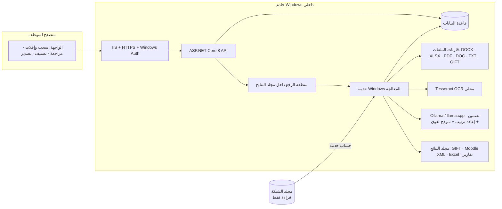
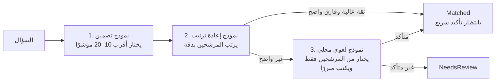

# واجهة بنك الأسئلة الداخلي: الأفكار والمقترحات وخطة التنفيذ

> **الحالة:** مقترح للنقاش، ولم يُنفَّذ منه شيء في التطبيق الحقيقي بعد.
> **النموذج التفاعلي:** `docs/interface/prototype.html`. افتحه في المتصفح، وكل بياناته وهمية.
> **المرجع:** حزمة `QuestionBankInternal_Claude_Handoff` (ملف التسليم، الـ README، النشر، خارطة الطريق، المخطط).

---

## 1. القرارات المحسومة من الإجابات

| # | السؤال | القرار | أثره على التصميم |
|---|---|---|---|
| 1 | الكود الحالي (Streamlit مع Anthropic API) | يُترك، والبناء يكون على .NET 8 حسب الحزمة | لا تخرج أي بيانات من الشبكة، وتقنية واحدة للخادم |
| 2 | نوع الرابط | موقع داخلي على خادم Windows، مثل `https://qbank.local` | IIS وشهادة داخلية وWindows Authentication |
| 3 | مصدر الملفات | سحب وإفلات **مع** متصفح لمجلد الشبكة | مساران للدخول ينتهيان في المعالجة نفسها |
| 4 | الصيغ الشائعة | Word وExcel | نبدأ بهما ونبني لهما أقوى قارئات |
| 5 | الصيغ الموجودة | كل الصيغ: DOCX، XLSX، PDF، DOC، XLS، TXT، GIFT | قارئ مستقل لكل صيغة، يُضاف على مراحل |
| 6 | تحديد الإجابة الصحيحة | بأكثر من طريقة | سلسلة من الكواشف مع درجة ثقة، وقوالب يتعلمها النظام (القسم 5) |
| 7 | أسئلة مصورة | موجودة | OCR محلي اختياري، ومراجعة بشرية إلزامية لنتائجه |
| 8 | المستخدمون | عدة أشخاص | أدوار وصلاحيات وتوزيع للمهام وسجل تدقيق |
| 9 | قاعدة البيانات | غير معروف | توصية: SQLite للتجربة ثم SQL Server Express أو SQL Server (القسم 8) |
| 10 | ذكاء اصطناعي محلي | مسموح | نموذج تضمين مع نموذج إعادة ترتيب ونموذج لغوي، كلها على الخادم (القسم 6) |
| 11 | نطاق النسخة الأولى | حسب التوصية | الإسقاط، الاستخراج، المعاينة والتصحيح، تصدير Excel وGIFT وMoodle XML. والتصنيف في النسخة الثانية |
| 12 | نموذج مرئي | مطلوب | `prototype.html` |

---

## 2. ملاحظات على الحزمة قبل البناء

هذه نقاط في الحزمة الأصلية أو في الطلب تحتاج انتباهًا. وضعت أمام كل نقطة إن كانت حقيقة أو تقديرًا.

1. **السحب والإفلات ينتج نسخة مرفوعة وليس مسارًا.** (حقيقة تقنية) المتصفح لا يعطي الخادم مسار الملف الأصلي على الشبكة. لذلك:
   - الملفات المسقطة تُحفظ في منطقة رفع منفصلة داخل مجلد النتائج، وليس في مجلد المصدر، فيبقى المصدر للقراءة فقط.
   - كل ملف مرفوع يُسجَّل بأصل "رفع يدوي" مع اسم من رفعه ووقت الرفع، حتى يبقى قابلًا للتتبع (القيد 8 في الحزمة).
2. **مجلد الشبكة كله (24.7 GB) لا يُرفع بالسحب.** (حقيقة) يُعالج من مكانه عبر متصفح المجلد، ويُقرأ بحساب الخدمة.
3. **الكود الحالي في المستودع يرسل النصوص إلى خدمة خارجية.** (حقيقة) `question-bank-app/ai_engine.py` يستدعي Anthropic API، وهذا يخالف القيد 1. اقتراحي أن يُنقل إلى مجلد `legacy/` أو يُحذف بعد موافقتك، وألا يُستخدم مع بيانات حقيقية.
4. **`appsettings.json` في الحزمة** فيه `AllowedHosts: localhost`، وهذا سيرفض الطلبات القادمة باسم `qbank.local`. يلزم تعديله عند النشر. (حقيقة)
5. **`/api/config/paths` بلا مصادقة.** (حقيقة) الكود نفسه يعلّق على ذلك. يجب أن يُحمى بدور "مدير النظام" قبل أي نشر.
6. **المخطط الأولي ينقصه:** جدول للمستخدمين والأدوار، وجدول لسجل التدقيق، وجدول للتصدير، وجدول لقوالب الاستخراج، وجدول لطبقة التصحيحات، وأصل الملف (مصدر أم رفع). اقتراح الإضافات في القسم 8. (حقيقة، بمراجعة الملف)
7. **أكبر خطر هو دقة الاستخراج وليس الواجهة.** (تقدير بثقة عالية) ملفات Word تأتي بأشكال كثيرة، ولا يمكن قياس الدقة بدون عينات. الحل في القسم 5: قوالب، وكواشف متعددة، ودرجة ثقة لكل سؤال.

---

## 3. البنية العامة



**المبادئ:**
- الواجهة لا تعالج شيئًا بنفسها. هي تضيف ملفات أو مجلدات إلى طابور في قاعدة البيانات، والعامل الخلفي (Windows Service) يعالجها على دفعات ويستأنف بعد أي توقف.
- لا يوجد اتصال خارجي. النموذج اللغوي يعمل على الخادم نفسه أو على خادم داخلي آخر، ويُمنع وصوله للإنترنت بجدار الحماية.
- التحديث الحي للحالة (نسبة الإنجاز، الملفات المكتملة) يصل للمتصفح عبر SignalR، المضمّن في ASP.NET Core.

---

## 4. الشاشات والأفكار لكل شاشة

كل شاشة لها مهمة واحدة. كل عملية سحب لها بديل بالنقر، لأن السحب لا يعمل جيدًا على اللمس ولا مع لوحة المفاتيح.

### 4.1 لوحة الحالة
- أربعة أرقام في الأعلى: الملفات المكتشفة، التي عولجت (مع شريط ونسبة ووقت متوقع)، الأسئلة المستخرجة، الأسئلة التي تحتاج مراجعة.
- توزيع الصيغ في المجلد، ويفيد في تحديد أي قارئ نبنيه أولًا بأرقام حقيقية.
- جدول حالات الملفات: مكتمل، قيد المعالجة، يحتاج مراجعة، فشل، تم تخطيه، بالانتظار. الضغط على أي حالة يفتح قائمة ملفاتها.
- ما يظهر يختلف حسب الدور: المراجع يرى ما ينتظره هو، والمسؤول يرى كل شيء.

### 4.2 إسقاط الملفات
- منطقة إسقاط كبيرة تقبل ملفات ومجلدات (بما فيها المجلدات الفرعية) وملفات ZIP.
- **رفع قابل للاستئناف** ببروتوكول tus: مكتبة `tusdotnet` على الخادم و`Uppy` في المتصفح، والمكتبتان مستضافتان داخليًا بدون CDN. إذا انقطعت الشبكة يكمل الرفع من حيث توقف.
- **كشف التكرار ببصمة SHA-256** عند الرفع: "هذا الملف رُفع سابقًا في 3/10 بواسطة فلان".
- بطاقة لكل ملف بحالته، ورسائل خطأ بلغة مفهومة:
  - "محمي بكلمة مرور"
  - "تالف أو لا يُفتح"
  - "PDF مصوّر، سيُقرأ بالتعرف الضوئي"
  - "لم تُكتشف أسئلة، افتحه لتعليم النظام شكله"
- حدود يضبطها المسؤول: الحجم الأقصى للملف، والصيغ المسموحة، وعدد الملفات في المرة الواحدة.
- فحص الملفات المرفوعة بمضاد الفيروسات المعتمد في المؤسسة قبل المعالجة (Windows Defender عبر `MpCmdRun` أو حل المؤسسة).

### 4.3 متصفح مجلد الشبكة
- شجرة مجلدات بالمسارات النسبية فقط. المسار الحقيقي على الخادم لا يظهر أبدًا.
- بجانب كل مجلد: عدد ملفاته، وكم عولج منها، ولون حسب الحالة.
- سحب المجلد إلى "قائمة المعالجة"، أو زر "عالج هذا المجلد".
- لكل مهمة: شريط تقدم، وإيقاف مؤقت، واستئناف، وأولوية.
- عند تغيّر ملف في المصدر (تاريخ التعديل أو البصمة) يظهر "تغيّر منذ آخر معالجة" مع زر لإعادة المعالجة.

### 4.4 مطابقة الأعمدة (Excel)
- أعمدة الملف تظهر كبطاقات، وتُسحب إلى الحقول: رمز السؤال، النص، الخيارات من أ إلى و، الإجابة الصحيحة، الصعوبة، المؤشر إن وُجد.
- زر "اقترح المطابقة" يخمّن من أسماء الأعمدة (مثل: السؤال، البديل، الإجابة، Answer، Option)، والمستخدم يؤكد.
- معاينة حية لأول 3 صفوف.
- **القوالب:** تُحفظ المطابقة باسم، وأي ملف لاحق له نفس بصمة الأعمدة (أسماؤها وترتيبها) يُطابق تلقائيًا. بهذا يُعالج عدد كبير من ملفات Excel بعد تعليم بضعة قوالب فقط.
- دعم الحالات الصعبة:
  - الإجابة كحرف ("ب") أو رقم ("2") أو نص الخيار نفسه.
  - كل الخيارات في عمود واحد يفصل بينها رمز.
  - أكثر من ورقة في الملف.
  - صفوف عناوين مدمجة فوق الجدول.

### 4.5 المراجعة والتصحيح (شاشة مقسومة)
- قائمة الأسئلة على اليمين، ولكل سؤال إشارة: 🟢 ثقة عالية، 🟡 متوسطة، 🔴 تحتاج تدخلًا.
- السؤال المختار مع خياراته، وتحته **مقتطف من المصدر** يظلّل مكانه. في التطبيق الحقيقي يمكن عرض الصفحة نفسها من PDF أو Word محوّلة لصورة.
- **طبقة التصحيح:** الضغط على خيار يجعله الإجابة الصحيحة، لكن القيمة الأصلية تبقى محفوظة كما هي (القيد 4). كل تصحيح يسجّل من صححه ومتى، والقيمة قبل التصحيح.
- أدوات بلا تعديل للنص الأصلي: دمج سؤالين قسمهما القارئ خطأ، فصل سؤال دُمج خطأ، تعليم "ليس سؤالًا".
- اختصارات: J وK للتنقل، A للاعتماد، F للتعليم للجنة.
- **التراجع بدل رسائل التأكيد:** بعد كل عملية يظهر "تم · تراجع" لمدة 5 ثوانٍ.
- فلاتر: بانتظار المراجعة، معتمدة، معلّمة، حسب الملف أو المجلد أو مستوى الثقة.

### 4.6 التصنيف على الإطار (النسخة الثانية)
- شجرة الإطار المعتمد: المجال الرئيسي، ثم الفرعي، ثم المؤشر مع رمزه **حرفيًا**.
- يظهر رقم الإصدار، مثل "إطار وظيفة إدارية · إصدار 2.1"، ويُحفظ مع كل ربط.
- طرق الربط:
  - سحب السؤال إلى المؤشر.
  - النقر على أحد اقتراحات النموذج الثلاثة (مع النسبة المئوية والمبرر).
  - تحديد عدة أسئلة ثم نقرة على مؤشر.
- بجانب كل مؤشر عدد أسئلته، والمؤشر الذي ليس له أي سؤال يظهر بالأحمر. هذه بداية تقرير التغطية.
- **لا يوجد زر لإنشاء مؤشر أو تعديله.** المؤشرات تُستورد من ملف الإطار فقط (القيد 3).

### 4.7 سلة التصدير
- سحب الأسئلة المعتمدة إلى السلة، أو إضافتها بالفلاتر: التخصص، المجال، المؤشر، الحالة، المصدر.
- قبل التصدير يعمل **فحص البنية**:
  - إجابة صحيحة واحدة.
  - خياران على الأقل.
  - هروب الرموز الخاصة في GIFT: `~ = # { } :` و`\`.
  - ترميز UTF-8.
  - الأسئلة المرفوضة تظهر في تقرير أخطاء ولا تدخل الملف (القيد 9).
- كل سؤال في GIFT يُسبق بتعليق فيه الرمز والمصدر والموقع والمؤشر والإطار، فيمكن تتبعه بعد الاستيراد.
- **ثلاث صيغ للتصدير:** GIFT، وMoodle XML، وتقرير Excel. تفاصيل XML في القسم 4.7.1.

#### 4.7.1 تصدير Moodle XML
مثال لسؤال واحد كما يخرج من النموذج التفاعلي:

```xml
<?xml version="1.0" encoding="UTF-8"?>
<quiz>
  <question type="category">
    <category><text>$course$/top/إطار وظيفة إدارية - إصدار 2.1/1. التخطيط والتنظيم/1.1 إدارة الأولويات/1.1.1</text></category>
  </question>
  <!-- Q-000108 | مصدر: إداري/2024/اختبار-محاسب.xlsx | صف 5 -->
  <question type="multichoice">
    <name><text>Q-000108</text></name>
    <questiontext format="html"><text><![CDATA[<p dir="rtl">أي أداة تساعد على ترتيب المهام حسب الأهمية والإلحاح؟</p>]]></text></questiontext>
    <idnumber>Q-000108</idnumber>
    <single>true</single>
    <shuffleanswers>false</shuffleanswers>
    <answernumbering>none</answernumbering>
    <answer fraction="0" format="html"><text><![CDATA[<p dir="rtl">مخطط جانت</p>]]></text></answer>
    <answer fraction="100" format="html"><text><![CDATA[<p dir="rtl">مصفوفة أيزنهاور</p>]]></text></answer>
    <answer fraction="0" format="html"><text><![CDATA[<p dir="rtl">خريطة ذهنية</p>]]></text></answer>
    <answer fraction="0" format="html"><text><![CDATA[<p dir="rtl">قائمة مراجعة</p>]]></text></answer>
    <tags><tag><text>indicator:1.1.1</text></tag><tag><text>framework:2.1</text></tag></tags>
  </question>
</quiz>
```

| القرار | السبب |
|---|---|
| `type="multichoice"` مع `single=true` | سؤال اختيار من متعدد بإجابة واحدة، مثل GIFT |
| فئة لكل مؤشر (`question type="category"`) بالمسار: الإطار، ثم المجال، ثم الفرعي، ثم المؤشر | تُنشأ الفئات تلقائيًا في بنك أسئلة Moodle عند الاستيراد، فتسهل بناء اختبار يسحب أسئلة عشوائية من كل مؤشر. يمكن إيقافها من خيار في السلة |
| `idnumber` و`name` = المعرّف الثابت | تتبع السؤال بعد الاستيراد، ومنع الالتباس عند الاستيراد مرة ثانية |
| `shuffleanswers=false` افتراضيًا | الحفاظ على ترتيب الخيارات الأصلي (القيد 4). خيار في السلة يسمح بالخلط عند الحاجة |
| `answernumbering=none` | ترقيم Moodle بحروف لاتينية (a, b, c) لا يناسب الأسئلة العربية |
| النص داخل `<p dir="rtl">` وCDATA | اتجاه صحيح في Moodle، وهروب آمن للرموز. أي `]]>` داخل النص يُقسَّم تلقائيًا |
| وسوم (tags) للمؤشر والإطار والمصدر | بحث وفلترة داخل Moodle |
| تعليق قبل كل سؤال بالمصدر والموقع | تتبع، ولا يؤثر على الاستيراد |
| فحص سلامة بنية XML قبل الكتابة | ملف تالف لا يخرج من النظام (القيد 9) |

**مزايا XML على GIFT:** يدعم الصور (مضمّنة بـ base64)، والوسوم، و`idnumber`، والتغذية الراجعة بتنسيق HTML، وأنواع أسئلة أخرى لاحقًا. **عيبه:** ملف أكبر وأصعب في القراءة اليدوية. لذلك نصدّر الصيغتين ويختار المستخدم.

**الاختبارات المطلوبة في التطبيق الحقيقي:**
- التحقق من XML بمحلل حقيقي (`System.Xml` في .NET).
- اختبار ذهاب وعودة: تصدير، ثم استيراد في Moodle تجريبي، ثم تصدير من Moodle ومقارنة النص والخيارات والإجابة.
- عينات فيها رموز خاصة: `& < > ]]> { } ~ =`، ونص مختلط عربي وإنجليزي، وأرقام.
- تقرير Excel فيه أوراق منفصلة: جرد الملفات، الأسئلة، المطابقات، التكرار، التغطية، الأخطاء.
- كل عملية تصدير تُحفظ بإعداداتها ومن طلبها، ويمكن إعادة إنشائها لاحقًا.

### 4.8 أفكار إضافية للمراحل القادمة

| الفكرة | الفائدة | المرحلة المقترحة |
|---|---|---|
| بحث شامل بالنص أو الرمز مع فلاتر | الوصول لأي سؤال في ثوانٍ | 2 |
| مجموعات التكرار جنبًا إلى جنب، واللجنة تختار النسخة المعتمدة | معالجة التكرار بدون حذف تلقائي | 3 |
| خريطة حرارية للتغطية: مؤشر مقابل عدد الأسئلة والصعوبة | معرفة النقص فورًا | 3 |
| توزيع المهام على المراجعين حسب التخصص مع عداد إنجاز | تنظيم عمل عدة أشخاص | 2 |
| مراجعة ثنائية للأسئلة منخفضة الثقة | تقليل الأخطاء | 3 |
| قوالب استخراج Word (الإجابة بالأحمر، جدول في آخر الملف...) | رفع دقة ملفات Word | 1–2 |
| فحص سلامة النص كاقتراحات فقط | جودة بدون تعديل تلقائي | 3 |
| معاينة السؤال كما سيظهر في Moodle | اكتشاف مشاكل العرض قبل الاستيراد | 3 |
| صور الأسئلة المصورة داخل Moodle XML (base64) | أسئلة الصور تنتقل كاملة إلى Moodle | 4 |
| إشعارات داخل التطبيق | معرفة انتهاء الدفعات والأخطاء | 2 |
| سجل تدقيق قابل للبحث | المساءلة والتتبع | 1 |

### 4.9 مبادئ السهولة
1. **بدون تسجيل دخول:** Windows Authentication يتعرف على الموظف من حسابه في الشبكة. الأدوار تأتي من مجموعات Active Directory، مثل `QB-Admins` و`QB-Reviewers`.
2. **العربية أولًا:** اتجاه RTL كامل، وخط عربي واضح (IBM Plex Sans Arabic أو ما يعادله) مستضاف على الخادم.
3. **كل سحب له بديل بالنقر ولوحة المفاتيح**، للوصولية وللأجهزة اللمسية.
4. **رسائل بلغة المستخدم:** "الملف محمي بكلمة مرور" بدل `IOException 0x80070020`.
5. **لا نوافذ تأكيد مزعجة:** تراجع لمدة 5 ثوانٍ بعد كل عملية.
6. **حالة واضحة دائمًا:** لون ونص لكل حالة، وليس اللون وحده.
7. **الواجهة لا تعرض مسارات الخادم أو أسرار الإعدادات أبدًا.**

---

## 5. استخراج الأسئلة

### 5.1 القارئات حسب الصيغة

| الصيغة | المكتبة المقترحة (.NET، محلية) | ملاحظات | الأولوية |
|---|---|---|---|
| DOCX | `DocumentFormat.OpenXml` (من Microsoft، رخصة MIT) | يقرأ الفقرات والجداول والتنسيق: لون، خط عريض، تظليل. التنسيق ضروري لكشف الإجابة | 1 |
| XLSX | `ClosedXML` أو `DocumentFormat.OpenXml` | مع شاشة مطابقة الأعمدة والقوالب | 1 |
| XLS (قديم) | `ExcelDataReader` | قراءة فقط | 2 |
| DOC (قديم) | تحويل محلي إلى DOCX بـ LibreOffice headless، ثم قارئ DOCX | يحتاج تثبيت LibreOffice على الخادم. البديل التجاري Aspose.Words | 2 |
| TXT / MD | قارئ نصي مع أنماط ترقيم عربية وإنجليزية | يكتشف الترميز (UTF-8 أو Windows-1256) | 1 |
| GIFT | محلل GIFT مع اختبارات | القراءة ثم إعادة التصدير يجب أن تعطي النتيجة نفسها | 1 |
| PDF نصي | `UglyToad.PdfPig` (Apache 2.0) | استخراج النص بمواضعه، والعربية تحتاج معالجة لاتجاه النص | 2 |
| PDF مصوّر وصور | Tesseract OCR محلي مع بيانات `ara` و`eng` | دقته للعربية متوسطة (تقدير بثقة متوسطة)، ومراجعة نتائجه إلزامية | 3 |

**لكل قارئ:** حد أقصى للحجم، ومهلة زمنية، وعزل للأخطاء بحيث لا يوقف ملف تالف الدفعة كلها، واختبارات وحدة على عينات اصطناعية.

### 5.2 تحديد الإجابة الصحيحة بأكثر من طريقة

القارئ يجرّب سلسلة من **الكواشف** ويسجّل أيها نجح ودرجة ثقته:

| الكاشف | مثال | الثقة الافتراضية |
|---|---|---|
| عمود صريح في Excel | عمود "الإجابة" فيه "ب" أو "2" | عالية |
| صيغة GIFT | `=` قبل الخيار الصحيح | عالية |
| رمز نصي | `*` أو `✓` أو `(صح)` قبل الخيار أو بعده | عالية |
| جدول إجابات في آخر الملف | "1-ب، 2-ج، 3-أ" | عالية إذا تطابق عدد الأسئلة |
| تنسيق: خط عريض | خيار واحد فقط عريض بين الخيارات | متوسطة |
| تنسيق: لون أو تظليل | خيار واحد ملوّن بالأحمر أو مظلل | متوسطة |
| تنسيق: تسطير | خيار واحد مسطّر | متوسطة |
| لا شيء أو أكثر من مرشح | خياران عريضان مثلًا | **تحتاج تدخلًا** |

**القواعد:**
- إذا اتفق كاشفان على الخيار نفسه ترتفع الثقة. إذا تعارضا يُحال السؤال للمراجعة.
- إذا كانت كل الخيارات بنفس التنسيق، فالتنسيق لا يُعتبر دليلًا.
- **قوالب Word:** عندما يصحح المراجع ملفًا، يحفظ النظام "شكل" الملف (أنماط الترقيم، وطريقة الإجابة) ويطبقه على الملفات المشابهة من المجلد نفسه.

### 5.3 ما يُحفظ لكل سؤال
- معرّف ثابت: بصمة من (بصمة الملف + موقع السؤال في الملف)، فإعادة المعالجة لا تنتج أسئلة مكررة.
- النص الأصلي كما هو، والخيارات بترتيبها، والإجابة الأصلية، ورمز السؤال إن وُجد.
- الموقع في الملف: رقم الصفحة أو الفقرة أو الصف أو السطر.
- الكاشف المستخدم ودرجة الثقة.
- إصدار القارئ، حتى يُعرف أي الأسئلة تحتاج إعادة معالجة بعد تحسين القارئ.

---

## 6. الذكاء الاصطناعي المحلي

### 6.1 لماذا ثلاث طبقات بدل نموذج واحد؟
تشغيل نموذج لغوي كبير على كل سؤال، مقابل كل مؤشرات الإطار، بطيء جدًا على خادم داخلي. الحل خط معالجة من ثلاث مراحل:



- **النموذج اللغوي لا يرى إلا مؤشرات موجودة فعلًا في الإطار**، ويُجبر على اختيار رمز من قائمة مغلقة أو قول "لا يوجد مناسب". هذا يمنع اختراع المؤشرات (القيد 3).
- كل نتيجة تحفظ: الدرجة، والحالة، والمبرر، والمرشحين الثلاثة الأوائل، وإصدار الإطار، واسم النموذج وإصداره.

### 6.2 النماذج المقترحة (مرتبة)

> **مستوى الثقة: متوسط.** النماذج المفتوحة تتغير كل بضعة أشهر، والمقارنات العامة للعربية قليلة وبعضها من مصدر واحد. لذلك القرار النهائي يُتخذ **بتجربة على عينتكم** (القسم 6.4) وليس بالترتيب أدناه وحده.

**أ. نموذج التضمين (البحث عن أقرب المؤشرات)**

| الترتيب | النموذج | الرخصة | لماذا | الملاحظات |
|---|---|---|---|---|
| 1 | **BGE-M3** (BAAI) | MIT | يدعم أكثر من 100 لغة منها العربية، ويعمل على CPU بسرعة مقبولة، ونصوص حتى 8192 رمزًا | الخيار الآمن والمجرّب |
| 2 | Qwen3-Embedding (0.6B أو 4B) | Apache 2.0 | أحدث، وأداء قوي متعدد اللغات حسب تقارير المطورين | تحقق من نتيجته على العربية في تجربتكم |
| 3 | multilingual-e5-large | MIT | معروف وثابت | دراسة ArabicMTEB تُظهر أن نماذج مخصصة للعربية تتفوق عليه في معظم المهام العربية |

**ب. نموذج إعادة الترتيب**
- **bge-reranker-v2-m3** (Apache 2.0، متعدد اللغات). يرفع دقة الترتيب بين المرشحين بشكل ملحوظ، وتكلفته معقولة لأنه يعمل على 10–20 مرشحًا فقط.

**ج. النموذج اللغوي (المطابقة الصعبة وفحص سلامة النص)**

| الترتيب | النموذج | الرخصة | المزايا | العيوب | الذاكرة التقريبية (Q4) |
|---|---|---|---|---|---|
| 🥇 1 | **عائلة Qwen3، بحجم 14B أو 32B** (أو أحدث إصدار Qwen وقت التنفيذ) | Apache 2.0 | قوي متعدد اللغات ومنها العربية، يلتزم بإخراج JSON، أحجام متعددة، رخصة تجارية مفتوحة | ليس مخصصًا للعربية | 14B: نحو 9–10 GB · 32B: نحو 20 GB |
| 🥈 2 | Gemma 3 بحجم 27B | شروط Gemma من Google | متعدد اللغات، جيد في الفهم | رخصته ليست Apache، فراجعها قانونيًا. نتائجه على العربية غير موثقة جيدًا | نحو 17 GB |
| 🥉 3 | ALLaM-7B (SDAIA) | **تحقق من الرخصة على Hugging Face** | مخصص للعربية، وتقارير تشير لأداء لغوي عربي قوي | حجمه صغير، والمصادر متضاربة حول رخصته | نحو 5 GB |
| 4 | Jais (MBZUAI/G42) | راجع الرخصة | مخصص للعربية | أقدم وأقل التزامًا بالتعليمات المنظمة | 13B إلى 30B: من 8 إلى 20 GB |

**توصيتي:** Qwen3-14B كبداية، وهو يوازن بين الدقة والسرعة والذاكرة، ثم 32B إذا سمح العتاد وأظهرت التجربة فرقًا. ALLaM-7B مرشح ثانٍ يستحق التجربة لفحص سلامة النص العربي تحديدًا، بعد التأكد من رخصته.

**د. التشغيل**
- **Ollama** (MIT، يعمل على Windows) أو **llama.cpp server**. كلاهما يوفر واجهة HTTP محلية يستدعيها العامل الخلفي.
- يُمنع وصول الخادم للإنترنت بقاعدة في جدار الحماية. النماذج تُنزّل مرة واحدة من جهاز معتمد وتُنقل للخادم يدويًا بعد فحصها.
- **العتاد:**
  - **مع GPU** بذاكرة 16–24 GB (مثل NVIDIA L4 أو RTX 4000 Ada أو ما يعادلها): يكفي 14B بسهولة و32B بتكميم 4 بت.
  - **بدون GPU:** التضمين وإعادة الترتيب يعملان على CPU، أما النموذج اللغوي فيكون بطيئًا. استخدم 7B إلى 8B فقط وعلى الحالات الغامضة فقط.
- **تقدير زمني تقريبي (ثقة منخفضة، يحتاج قياسًا فعليًا):** لو كان عدد الأسئلة نحو 500 ألف، فالتضمين على CPU يستغرق ساعات إلى يوم. وإذا احتاج 20% منها للنموذج اللغوي بمعدل 2–4 ثوانٍ للسؤال على GPU، فالمدة نحو 2–5 أيام تشغيل متواصل، ويستأنف بعد أي توقف.

### 6.3 فحص سلامة النصوص
النموذج **يقترح ولا يعدّل**. كل ملاحظة تظهر للمراجع مع زر "تجاهل" أو "أحِل للجنة".

| الفحص | الطريقة | يحتاج نموذجًا لغويًا؟ |
|---|---|---|
| بنية: نص، خياران أو أكثر، إجابة واحدة | قواعد | لا |
| خيارات مكررة أو فارغة | قواعد | لا |
| "كل ما سبق" أو "لا شيء مما سبق" | قواعد | لا |
| طول الإجابة الصحيحة يكشفها (أطول بكثير من البقية) | إحصاء | لا |
| توازن مواضع الإجابات (أ/ب/ج/د) في المجموعة | إحصاء | لا |
| نفي مزدوج، أو كلمات مطلقة (دائمًا، أبدًا) | قواعد مع النموذج | جزئيًا |
| أخطاء إملائية ونحوية عربية | النموذج | نعم |
| خياران صحيحان، أو لا خيار صحيح منطقيًا | النموذج | نعم |
| غموض في صياغة السؤال | النموذج | نعم |
| تكرار حرفي | بصمة بعد تطبيع: إزالة التشكيل، توحيد الهمزات والتاء المربوطة والمسافات، دون تغيير النص المحفوظ | لا |
| شبه تكرار | تشابه نصي (MinHash أو تشابه حروف) | لا |
| تداخل مفاهيمي | تشابه التضمين ثم تأكيد بالنموذج | جزئيًا |

### 6.4 كيف نختار النموذج ونضبط الحدود
1. يختار المختصون عينة من **200–300 سؤال** من تخصصين أو ثلاثة، ويصنفونها يدويًا على الإطار. هذه "الإجابات المرجعية".
2. نشغّل كل نموذج مرشح على العينة نفسها ونقيس:
   - دقة المؤشر الأول (Top-1).
   - وجود المؤشر الصحيح ضمن الثلاثة الأوائل (Top-3).
   - الزمن لكل سؤال.
3. نحدد حدود الثقة من النتائج. مثال: فوق 0.85 مع فارق 0.15 عن المرشح الثاني تُعتبر "مطابقة"، وأقل من ذلك "تحتاج مراجعة". الأرقام النهائية تُحدد من التجربة وليس مسبقًا.
4. الحدود قابلة للتعديل من الإعدادات، وتُعاد التجربة عند تغيير النموذج أو الإطار.

---

## 7. الأدوار والصلاحيات

| الدور | ماذا يرى | ماذا يفعل |
|---|---|---|
| مدير النظام | الإعدادات وحالة الخادم والسجلات | يدير الأدوار والإعدادات والنماذج، بدون الاطلاع على نصوص الأسئلة إلا بصلاحية إضافية |
| مسؤول بنك الأسئلة | كل شيء | يضيف المجلدات، يرفع الملفات، يستورد الأطر، يوزع المهام، يصدّر |
| المراجع الفني | الأسئلة الموزعة عليه وما في تخصصه | يصحح، يصنف، يعتمد، يعلّم للجنة |
| مستخدم الاطلاع | الأسئلة المعتمدة ضمن تخصصه | يبحث ويطّلع فقط |

- الأدوار تُربط بمجموعات Active Directory.
- **سجل تدقيق** لكل عملية: من، ماذا، متى، القيمة قبل التغيير وبعده. لا يُسجَّل نص السؤال في سجلات النظام العامة (القيد 10)، ويُشار للسؤال برقمه فقط.

---

## 8. قاعدة البيانات

| الترتيب | الخيار | المزايا | العيوب | متى يُستخدم |
|---|---|---|---|---|
| 🥇 1 للتجربة | **SQLite** | بلا تثبيت، ملف واحد، مدعوم في EF Core | ضعيف مع كتابات متزامنة كثيرة. يقلّ هذا الضعف لأن الكاتب الرئيسي هو العامل الخلفي وحده | النموذج التجريبي والاختبار على عينة |
| 🥇 1 للإنتاج | **SQL Server** (الموجود لدى المؤسسة، أو Express) | متوافق مع الحزمة، نسخ احتياطي معروف لفرق تقنية المعلومات، بحث نصي كامل | Express محدود بحجم 10 GB لكل قاعدة | إذا كان SQL Server متوفرًا أو يمكن تثبيت Express |
| 3 | PostgreSQL | مجاني بلا حدود حجم، وبحث نصي وتشابه نصي ممتازان | فريق تقنية المعلومات قد لا يعرفه على Windows | إذا لم يتوفر SQL Server وتجاوز الحجم 10 GB |

**التوصية:** نكتب الكود بـ EF Core مع ترحيلات (migrations)، فيعمل على SQLite أولًا ثم ننقله إلى SQL Server بتغيير سطر الاتصال وإعادة الاختبار. **تقدير الحجم:** نصوص الأسئلة وحدها غالبًا أقل من بضعة GB (تقدير بثقة متوسطة)، فـ Express قد يكفي في البداية. التضمينات (vectors) تأخذ مساحة أكبر، ويمكن حفظها في ملفات منفصلة.

**جداول مقترحة إضافة للمخطط الأولي:**
- `Users`, `Roles`, `UserRoles`، أو الاكتفاء بمجموعات AD مع جدول تفضيلات فقط.
- `Uploads`: الملفات المرفوعة يدويًا، مع البصمة والرافع والوقت.
- `SourceFiles.Origin`: مصدر أو رفع.
- `ExtractionTemplates`: قوالب Excel وWord.
- `QuestionCorrections`: طبقة التصحيح (السؤال، الحقل، القيمة الأصلية، الجديدة، من، متى).
- `ReviewAssignments`: توزيع المهام.
- `QualityFindings`: ملاحظات الجودة والتكرار.
- `DuplicateGroups`, `DuplicateGroupMembers`.
- `Exports`: الإعدادات، من طلب، الملف الناتج، عدد الأسئلة المقبولة والمرفوضة.
- `AuditLog`.
- `ModelRuns`: النموذج وإصداره وإعداداته لكل عملية مطابقة.

---

## 9. التقنية المقترحة

| الطبقة | الاختيار | البديل |
|---|---|---|
| الخادم | ASP.NET Core 8، ثم الترقية إلى .NET 10 LTS بعد استقرار المشروع | — |
| الواجهة | Razor Pages أو Blazor Server، مع JavaScript خفيف للسحب والإفلات (HTML5 Drag & Drop، وSortableJS للقوائم) | React SPA إذا احتجنا تفاعلًا أعقد لاحقًا |
| الرفع | Uppy مع tusdotnet، مستضافان داخليًا | رفع عادي على أجزاء |
| التحديث الحي | SignalR | استطلاع دوري كل بضع ثوانٍ |
| المعالجة الخلفية | Windows Service مبنية على `BackgroundService` مع طابور في قاعدة البيانات | Hangfire |
| قاعدة البيانات | EF Core: SQLite ثم SQL Server | PostgreSQL |
| النماذج | Ollama أو llama.cpp عبر HTTP محلي | ONNX Runtime للتضمين داخل .NET مباشرة |
| التقارير | ClosedXML لملفات Excel | — |
| الاختبارات | xUnit، مع عينات اصطناعية لكل صيغة، واختبار ذهاب وعودة لـ GIFT | — |

**لماذا Razor أو Blazor وليس React؟** تقنية واحدة يصونها فريق صغير، وWindows Authentication يعمل بدون إعداد إضافي، والنشر على IIS مباشر. السحب والإفلات المطلوب يغطيه HTML5 مع مكتبة صغيرة، والنموذج التفاعلي المرفق مثال على ذلك بدون أي إطار عمل.

---

## 10. خطة المراحل

| المرحلة | المحتوى | معيار الإنجاز |
|---|---|---|
| **0. الأساس** (أسبوع) | build ناجح، Windows Auth، الأدوار، حماية `/api/config/paths`، EF Core مع SQLite، سجل تدقيق | يدخل مستخدم بحسابه ويرى دوره، ولا توجد صفحة بلا حماية |
| **1. الجرد** (1–2 أسبوع) | جرد قابل للاستئناف لمجلد الشبكة، متصفح المجلد، قائمة المعالجة، لوحة الحالة | الإيقاف وإعادة التشغيل لا يفقدان التقدم ولا يكرران النتائج، والمصدر لم يتغير |
| **2. الإسقاط والقارئات الأولى** (2–3 أسابيع) | منطقة الإسقاط مع tus والبصمة، وقارئات XLSX وDOCX وTXT وGIFT، ومطابقة الأعمدة والقوالب | دقة استخراج مقاسة على عينة اصطناعية، وكل ملف له حالة مفهومة |
| **3. المراجعة والتصدير** (2 أسبوع) | شاشة المراجعة، طبقة التصحيح، السلة، GIFT وMoodle XML وExcel مع الفحص | ملفا GIFT وXML يُستوردان في Moodle تجريبي بدون أخطاء، مع الفئات والترتيب والإجابات كما هي |
| **4. صيغ إضافية** (2 أسبوع) | XLS، DOC عبر LibreOffice، PDF نصي، OCR اختياري | اختبارات لكل قارئ، وحدود حجم ووقت |
| **5. الأطر والتصنيف** (3 أسابيع) | استيراد الأطر، التضمين وإعادة الترتيب والنموذج اللغوي، شاشة التصنيف، تجربة اختيار النموذج | Top-3 مقاس على عينة المختصين، ولا يوجد مؤشر خارج الإطار |
| **6. الجودة** (2 أسبوع) | التكرار بأنواعه، فحص السلامة، خريطة التغطية | تقارير منفصلة لكل نوع، وبلا حذف تلقائي |
| **7. الإنتاج** | اختبار الأداء والاستعادة وانقطاع SMB والملفات المقفلة والنسخ الاحتياطي | موافقة تقنية المعلومات ومسؤول بنك الأسئلة |

> المدد تقديرية لمطوّر واحد يعمل بدوام كامل، وتعتمد على سرعة الحصول على العينات والموافقات.

---

## 11. المخاطر والأخطاء الشائعة

| الخطر | الأثر | الوقاية |
|---|---|---|
| تنوع أشكال ملفات Word | استخراج خاطئ أو ناقص | قوالب، كواشف متعددة، درجة ثقة، ومراجعة بشرية للمنخفض منها |
| الاعتماد على درجة النموذج وحدها | تصنيف خاطئ يبدو مؤكدًا | مبرر محفوظ، وحدود مقاسة على عينة، واعتماد بشري |
| إرسال بيانات لخدمة خارجية بالخطأ | خرق سرية | منع الإنترنت عن الخادم بجدار الحماية، ومراجعة الحزم، وعدم استخدام CDN |
| رفع ملف خبيث | اختراق الخادم | فحص مضاد الفيروسات، وحدود الصيغ والحجم، ومعالجة بحساب محدود |
| تعديل المصدر بالخطأ | فقد بيانات أصلية | حساب الخدمة للقراءة فقط على مستوى NTFS والمشاركة معًا |
| OCR عربي ضعيف | نصوص مشوهة | اختياري، ويُعلَّم دائمًا كـ"يحتاج مراجعة" |
| تجاوز حد SQL Server Express (10 GB) | توقف الكتابة | مراقبة الحجم، والتضمينات خارج القاعدة، أو الترقية |
| الخلط بين إصدارات الأطر | ربط بمؤشر قديم | حفظ الإصدار مع كل ربط، وتنبيه عند استيراد إصدار جديد |
| تسجيل نصوص الأسئلة في السجلات | تسرب عبر ملفات السجل | سياسة سجلات: المعرّفات فقط، ومراجعة الكود |
| بطء النموذج اللغوي على CPU | معالجة تستغرق أسابيع | خط الطبقات الثلاث، والنموذج اللغوي للحالات الغامضة فقط، وGPU إن أمكن |
| مقاومة المستخدمين لأداة جديدة | قلة الاستخدام | واجهة بسيطة، وتدريب قصير، وتجربة مع 2–3 مراجعين قبل التعميم |

---

## 12. ما أحتاجه منك للبدء

1. **عينات:** 3–5 ملفات Word و3–5 ملفات Excel بالأشكال الحقيقية، بأسئلة وهمية أو مموهة، ويفضّل أن تغطي طرق تحديد الإجابة المختلفة.
2. **عينة إطار كفايات** بالشكل الحقيقي (Excel)، ولو بمؤشرات وهمية.
3. **سؤال لتقنية المعلومات:** هل يوجد SQL Server؟ وهل يمكن توفير GPU للخادم؟ وما سياسة مضاد الفيروسات؟
4. **موافقة** على نقل الكود الحالي (Streamlit) إلى `legacy/` أو حذفه.
5. **ملاحظاتك على النموذج التفاعلي:** ما الذي يجب أن يتغير قبل البناء الحقيقي؟

---

## المصادر

- حزمة التسليم: `CLAUDE_HANDOFF.md`، `README_AR.md`، `docs/DEPLOYMENT_AR.md`، `docs/ROADMAP_AR.md`، `database/schema.sql`.
- صيغة Moodle XML: [Moodle Docs: Moodle XML format](https://docs.moodle.org/en/Moodle_XML_format)
- مقارنات النماذج العربية المحلية (مصدر ثانوي واحد، وأرقامه تحتاج تحققًا): [PromptQuorum: Best Arabic local LLMs 2026](https://www.promptquorum.com/fr/local-llms/best-arabic-local-llms-2026) · [PromptQuorum: ALLaM](https://www.promptquorum.com/de/local-llms/best-saudi-arabic-local-llms-allam-2026)
- تقييم نماذج التضمين للعربية: [Swan and ArabicMTEB (NAACL Findings 2025)](https://arxiv.org/html/2411.01192v3)
- قبل الاعتماد: راجع بطاقات النماذج ورخصها على Hugging Face، ولوحة MTEB في تبويب العربية/متعدد اللغات.
